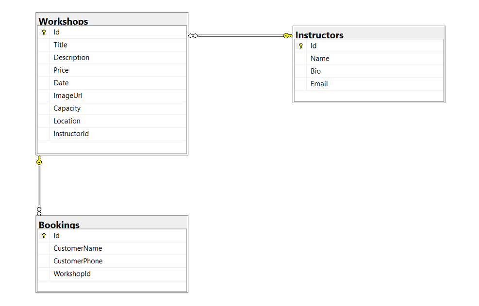

# Craft Workshops Booking System

**Prepared by:** Lujin Adham

## Description
The Craft Workshops Booking System is a web application designed to manage and book creative craft workshops such as pottery painting, crochet, and handmade crafts. The system allows users to browse upcoming workshops, view detailed schedules and seat availability, and secure their position by entering simple contact details. It features automated seat-tracking to ensure workshops don't exceed their maximum capacity.

Built as part of the ITI Web Development using .NET training.

## Key Features
- **Workshop Management:** Admins can add, update, and remove workshops with essential details including title, description, price, date, and total capacity.
- **Instructor Management:** Allows administrators to add, edit, and view instructors, and link each workshop to its respective instructor with dedicated profile details pages.
- **Simple Booking System:** Users can register for available workshops by providing their name and phone number, without complex authentication processes.
- **Interactive Catalog & Seat Tracking:** Displays upcoming workshop schedules, pricing, available seats, and automatically flags fully booked sessions.
- **Admin Overview:** Allows administrators to manage workshop listings and instructor profiles.

## Reporting and Analytics
- **Capacity & Availability Tracking:** Monitors total capacity versus remaining seats for each workshop session to prevent overbooking.
- **Participant & Booking Records:** Keeps a record of all registered participants and bookings.

## Technologies & Tools
- **Backend:** C# with ASP.NET Core MVC, Entity Framework Core
- **Frontend:** Razor Views, HTML/CSS, Bootstrap 5
- **Database:** Microsoft SQL Server
- **Architecture:** Layered architecture with a dedicated Business Logic Layer (BLL) for clean data management and business operations

## Database Entity-Relationship Diagram (ERD)
The following diagram illustrates the database schema, including all entities (Workshops, Instructors, and Bookings), their attributes, and the relationships between them:



## How to Run
1. Install the .NET SDK and SQL Server (or SQL Server Express).
2. Update the connection string in `appsettings.json` if needed.
3. Apply the database migrations:
   ```
   dotnet ef database update
   ```
4. Run the project:
   ```
   dotnet run
   ```